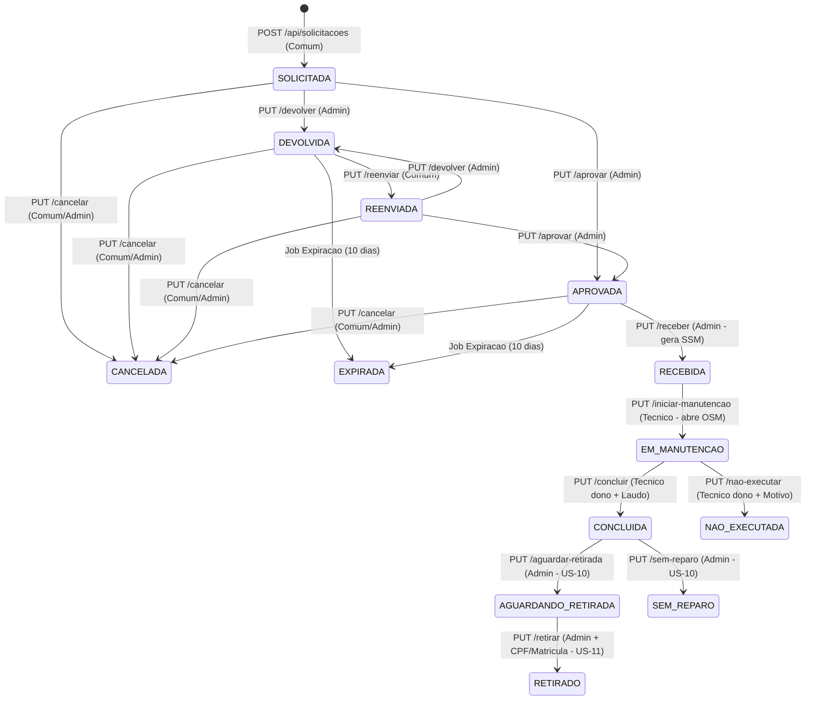

# 🚆 CPTM — Sistema de Gestão de Manutenção (Backend API)

API RESTful em **.NET 10** responsável por gerenciar o ciclo de vida completo das **Solicitações de Serviço Local (SSL)** e **Ordens de Serviço de Manutenção (OSM)** de equipamentos de estações da CPTM, atendendo simultaneamente ao aplicativo **Mobile** (Operador de Estação e Técnico de Oficina) e ao painel **Web** (Administrativo e Logística).

- **Repositório Backend:** [PROJ_II_SISTEMA_DE_MANUTENCAO_BACKEND](https://github.com/D-Franca-Almeida/PROJ_II_SISTEMA_DE_MANUTENCAO_BACKEND)
- **Repositório Frontend (Web & Mobile):** [PROJ_II_SISTEMA_DE_MANUTENCAO_FRONTEND](https://github.com/D-Franca-Almeida/PROJ_II_SISTEMA_DE_MANUTENCAO_FRONTEND)

---

## 🛠️ Stack e Arquitetura

- **.NET 10 / ASP.NET Core Web API** (C#)
- **Entity Framework Core 10** com suporte a múltiplos provedores (`Sqlite` para desenvolvimento/testes e `Oracle` 19c para homologação via `Database:Provider`)
- **Autenticação JWT (`Bearer`) e Autorização RBAC** em 3 perfis: `Comum`, `Tecnico` e `Administrativo` (senhas com hash `PBKDF2` e proteção contra *timing attack*)
- **Controle de Concorrência Otimista:** Coluna `Status` como *Concurrency Token* em `SOLICITACOES` e `PEDIDO_PECA` (retorna `409 Conflict` em corridas simultâneas)
- **Auditoria Completa (US-16):** Toda mudança de estado grava automaticamente uma linha em `HISTORICO_STATUS` na mesma transação
- **Armazenamento e Mensageria em Nuvem (Microsoft Azure):**
  - **Azure Blob Storage (`AzureBlobFotoStorage`):** Armazena as fotos das SSLs no container `uploads` da Storage Account `stcptmmanut2026` (com *fallback* automático para disco local quando a connection string não está configurada)
  - **Azure Queue Storage (`AzureQueueNotificacaoService`):** Publica eventos JSON na fila `eventos-manutencao` a cada tentativa de login (`LOGIN_SUCESSO` / `LOGIN_FALHA`) e a cada transição de status (`MUDANCA_STATUS`)
- **Background Service (US-20):** Job periódico (`ExpiracaoBackgroundService`) que expira solicitações `DEVOLVIDA` ou `APROVADA` sem movimentação após o prazo configurável (padrão: 10 dias)
- **Testes Automatizados (TDD):** **384 testes** (`xUnit` + `WebApplicationFactory` + `Coverlet`) executados em pipeline **GitHub Actions**
- **Conteinerização e Nuvem:** `Dockerfile` multi-stage (usuário não-root), `docker-compose.yml`, endpoint `/health` e roteiro de deploy para **Microsoft Azure Container Apps**

---

## 🔄 Máquina de Estados da Solicitação (SSL)



---

## 📂 Estrutura do Repositório

```text
├── CPTM.Manutencao.Api/
│   ├── Controllers/          # Endpoints HTTP REST e políticas RBAC
│   ├── Data/                 # ManutencaoDbContext, Repositories, HealthCheck, Seed (DadosIniciais) e Migrations
│   ├── Models/               # Entidades de domínio, constantes de status e DTOs
│   ├── Services/             # Regras de negócio (WorkflowService, SolicitacaoService, PedidoPecaService, AuthService, ExpiracaoService, FotoStorage)
│   └── Program.cs            # DI, JWT, CORS, Swagger, HealthChecks e aplicação automática de Migrations
├── CPTM.Manutencao.Tests/
│   ├── Integracao/           # 13 suítes de testes HTTP ponta a ponta (WebApplicationFactory)
│   └── *Tests.cs             # 8 suítes de testes unitários de serviços e domínio
├── deploy/azure/             # Roteiro passo a passo de deploy no Azure Container Apps
├── .github/workflows/        # Pipelines de CI (build + testes + cobertura) e CD (Azure)
├── Dockerfile                # Build multi-stage .NET 10
└── docker-compose.yml        # Execução local em container com volume persistente
```

---

## 🚀 Como Executar Localmente

### Pré-requisitos
- [.NET 10 SDK](https://dotnet.microsoft.com/download/dotnet/10.0)

### 1. Clonar, restaurar e rodar a API

```powershell
git clone https://github.com/D-Franca-Almeida/PROJ_II_SISTEMA_DE_MANUTENCAO_BACKEND.git
cd PROJ_II_SISTEMA_DE_MANUTENCAO_BACKEND

dotnet restore CPTM.Manutencao.Tests/CPTM.Manutencao.Tests.csproj
dotnet run --project CPTM.Manutencao.Api
```

- **Swagger UI:** `http://localhost:5203/swagger`
- **Health Check:** `http://localhost:5203/health`

> Ao iniciar em ambiente `Development`, a API aplica automaticamente todas as migrations no banco SQLite local e popula a massa de dados inicial (`DadosIniciais.cs`).

### 2. Executar a Suíte de Testes (383 testes)

```powershell
dotnet test CPTM.Manutencao.Tests
```

### 3. Executar via Docker (Opcional)

```powershell
Copy-Item .env.example .env
# Edite o arquivo .env definindo uma JWT_KEY com pelo menos 32 caracteres
docker compose up --build
```
- **Swagger no Container:** `http://localhost:8080/swagger`
- **Health Check no Container:** `http://localhost:8080/health`

---

## 🔐 Credenciais Padrão (Carga Inicial / Seed)

Use o endpoint `POST /api/Auth/login` no Swagger e cole o token retornado no botão **Authorize**:

| Perfil | Matrícula | Senha | Permissões Principais |
| :--- | :--- | :--- | :--- |
| **Administrativo** | `admin123` | `senha` | Fila geral, aprovar, devolver, cancelar, receber na oficina (gerar SSM), logística de peças, definir destino (`aguardar-retirada` / `sem-reparo`) e protocolo de retirada (`retirar`) |
| **Técnico** | `tec123` | `senha` | Fila de recebidas, iniciar manutenção (abrir OSM), solicitar/cancelar peças, concluir OSM com laudo ou registrar não execução |
| **Comum** | `comum123` | `senha` | Abrir SSL com foto, consultar minhas solicitações, corrigir/reenviar devolvidas e cancelar própria solicitação (até `APROVADA`) |

---

## 📡 Catálogo de Endpoints da API

### Autenticação e Saúde
| Método | Rota | Acesso | Descrição |
| :--- | :--- | :--- | :--- |
| `POST` | `/api/Auth/login` | Público | Autentica por matrícula/senha e retorna o token JWT |
| `GET` | `/health` | Público | Verifica a saúde da API e conectividade com o banco de dados |

### Catálogo Patrimonial
| Método | Rota | Acesso | Descrição |
| :--- | :--- | :--- | :--- |
| `GET` | `/api/estacoes` | Autenticado | Lista as estações e linhas da CPTM |
| `GET` | `/api/equipamentos` | Autenticado | Lista equipamentos (filtro opcional `?estacaoId=`) |

### Solicitações de Serviço Local (SSL)
| Método | Rota | Acesso | Descrição |
| :--- | :--- | :--- | :--- |
| `GET` | `/api/Solicitacoes` | `Administrativo` | Lista todas as SSLs (filtro opcional `?status=`) com cálculo de dias para expirar |
| `GET` | `/api/Solicitacoes/recebidas` | `Tecnico` | Fila da oficina: lista SSLs com status `RECEBIDA` (mais antigas primeiro) |
| `GET` | `/api/Solicitacoes/minhas` | Autenticado | Lista as SSLs abertas pelo usuário logado |
| `GET` | `/api/Solicitacoes/{id}` | Autenticado | Detalhe completo da SSL + linha do tempo de `historico` |
| `POST` | `/api/Solicitacoes` | `Comum` | Abre nova SSL (`multipart/form-data` com `equipamentoId`, `descricao` e `foto` JPG/PNG até 5 MB) |
| `PUT` | `/api/Solicitacoes/{id}/reenviar` | `Comum` (dono) | Corrige descrição e/ou foto de SSL `DEVOLVIDA` → `REENVIADA` |
| `PUT` | `/api/Solicitacoes/{id}/aprovar` | `Administrativo` | Aprova na triagem (`SOLICITADA`/`REENVIADA` → `APROVADA`) |
| `PUT` | `/api/Solicitacoes/{id}/devolver` | `Administrativo` | Devolve para correção com motivo obrigatório (`→ DEVOLVIDA`) |
| `PUT` | `/api/Solicitacoes/{id}/cancelar` | `Comum` (dono) / `Admin` | Cancela SSL nas fases iniciais (até `APROVADA` → `CANCELADA`) |
| `PUT` | `/api/Solicitacoes/{id}/receber` | `Administrativo` | Registra chegada física na oficina e gera número `SSM-AAAA-NNNNNN` (`APROVADA` → `RECEBIDA`) |
| `PUT` | `/api/Solicitacoes/{id}/iniciar-manutencao` | `Tecnico` | Assume equipamento na oficina e abre a OSM (`RECEBIDA` → `EM MANUTENCAO`) |
| `PUT` | `/api/Solicitacoes/{id}/concluir` | `Tecnico` (dono OSM) | Conclui a OSM com laudo técnico; bloqueia se houver pedido de peça pendente (`→ CONCLUIDA`) |
| `PUT` | `/api/Solicitacoes/{id}/nao-executar` | `Tecnico` (dono OSM) | Encerra OSM como não executada com motivo e cancela peças pendentes (`→ NAO EXECUTADA`) |
| `PUT` | `/api/Solicitacoes/{id}/aguardar-retirada` | `Administrativo` | **US-10:** Libera equipamento consertado para busca pela estação (`CONCLUIDA` → `AGUARDANDO RETIRADA`) |
| `PUT` | `/api/Solicitacoes/{id}/sem-reparo` | `Administrativo` | **US-10:** Classifica equipamento como perda total/baixa técnica (`CONCLUIDA` → `SEM REPARO`) |
| `PUT` | `/api/Solicitacoes/{id}/retirar` | `Administrativo` | **US-11:** Registra protocolo final de retirada com CPF/matrícula do recebedor (`AGUARDANDO RETIRADA` → `RETIRADO`) |

### Ordens de Serviço (OSM) e Logística de Peças
| Método | Rota | Acesso | Descrição |
| :--- | :--- | :--- | :--- |
| `GET` | `/api/ordens-servico/minhas` | `Tecnico` | Lista as OSMs assumidas pelo técnico logado |
| `POST` | `/api/ordens-servico/{id}/pecas` | `Tecnico` (dono OSM) | Requisita peça ao almoxarifado para uma OSM em manutenção (`→ SOLICITADO`) |
| `GET` | `/api/ordens-servico/{id}/pecas` | `Tecnico` (dono) / `Admin` | Lista os pedidos de peça de uma OSM |
| `GET` | `/api/pedidos-peca` | `Administrativo` | Aba de logística: lista pedidos de peça (filtro `?status=` ou `PENDENTES`) |
| `PUT` | `/api/pedidos-peca/{id}/encaminhar` | `Administrativo` | Encaminha pedido ao almoxarifado (`SOLICITADO` → `ENCAMINHADO`) |
| `PUT` | `/api/pedidos-peca/{id}/receber` | `Administrativo` | Confirma chegada da peça na oficina (`ENCAMINHADO` → `RECEBIDO`) |
| `PUT` | `/api/pedidos-peca/{id}/cancelar` | `Tecnico` (dono OSM) | Cancela pedido de peça ainda pendente (`→ CANCELADO`) |

### Administração
| Método | Rota | Acesso | Descrição |
| :--- | :--- | :--- | :--- |
| `POST` | `/api/admin/expiracao/executar` | `Administrativo` | Dispara manualmente a verificação de expiração de SSLs ociosas |
| `GET` | `/api/admin/eventos-fila` | `Administrativo` | Lista os últimos eventos publicados na fila de mensageria (Login e Mudanças de Status) |

---

## ☁️ Configuração do Azure Blob + Queue Storage (Opcional para Dev Local)

Por padrão, se nenhuma chave da Azure estiver configurada na máquina, a API funciona 100% usando **disco local** (`wwwroot/uploads`) e **fila em memória** (nenhum teste quebra).

Para conectar sua máquina local à Storage Account real do projeto (`stcptmmanut2026` — container `uploads` e fila `eventos-manutencao`), basta registrar a *Connection String* no **User Secrets** do .NET (fora do Git):

```powershell
dotnet user-secrets set "AzureStorage:ConnectionString" "<COLE_A_CONNECTION_STRING_AQUI>" --project CPTM.Manutencao.Api/CPTM.Manutencao.Api.csproj
```

---

## ☁️ Deploy em Nuvem (Microsoft Azure)

O guia completo de provisionamento no **Azure Container Apps**, **Azure Container Registry**, **Log Analytics** e configuração de Secrets no GitHub Actions está em:
- [`deploy/azure/ROTEIRO-DEPLOY-AZURE.md`](deploy/azure/ROTEIRO-DEPLOY-AZURE.md)
