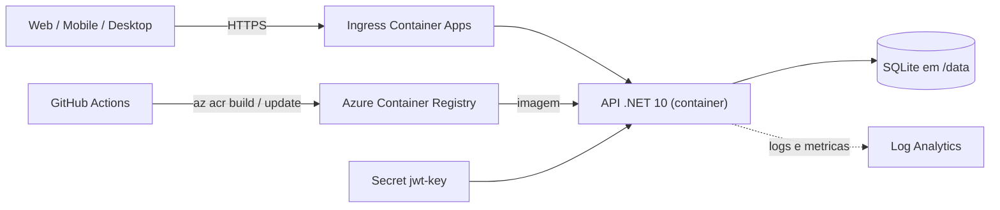

# Roteiro de deploy na Azure (Container Apps)

Passo a passo para publicar a API em container na Azure, com segredos fora do código, escala configurada,
logs/métricas e health check. Comandos de **Azure CLI** (`az`), rodando no PowerShell ou no Azure Cloud Shell.

> Estado atual: a API usa **SQLite** (arquivo em `/data`) e grava as fotos em disco. Por isso, na primeira
> publicação, o app roda com **1 réplica fixa** (SQLite não suporta várias réplicas escrevendo). Veja a seção
> "Limitações e próximos passos" para a escalabilidade horizontal real.

## 0. Pré-requisitos

- Conta Azure com assinatura ativa e `az` instalado (`az login`).
- Extensão: `az extension add --name containerapp --upgrade`
- Providers: `az provider register --namespace Microsoft.App` e `--namespace Microsoft.OperationalInsights`

## 1. Variáveis (ajuste os nomes; ACR e app precisam ser únicos/minúsculos)

```powershell
$RG   = "rg-cptm-manutencao"
$LOC  = "brazilsouth"
$ACR  = "cptmmanutencaoacr"        # 5-50 caracteres, só letras minúsculas e números
$ENV  = "cae-cptm"
$APP  = "ca-cptm-api"
$LOGS = "log-cptm"
# Chave JWT NOVA (a antiga esteve no Git e deve ser considerada vazada):
$JWT  = [Convert]::ToBase64String((1..48 | ForEach-Object { Get-Random -Maximum 256 }))
```

## 2. Recursos base (grupo, logs, registry)

```powershell
az group create -n $RG -l $LOC
az monitor log-analytics workspace create -g $RG -n $LOGS -l $LOC
az acr create -g $RG -n $ACR --sku Basic
```

## 3. Build da imagem na nuvem (não precisa de Docker local)

Na raiz do repositório (onde está o `Dockerfile`):

```powershell
az acr build --registry $ACR --image cptm-manutencao-api:v1 .
```

## 4. Ambiente e Container App

```powershell
$LOGID  = az monitor log-analytics workspace show -g $RG -n $LOGS --query customerId -o tsv
$LOGKEY = az monitor log-analytics workspace get-shared-keys -g $RG -n $LOGS --query primarySharedKey -o tsv
az containerapp env create -g $RG -n $ENV -l $LOC --logs-workspace-id $LOGID --logs-workspace-key $LOGKEY

az containerapp create -g $RG -n $APP --environment $ENV `
  --image "$ACR.azurecr.io/cptm-manutencao-api:v1" `
  --registry-server "$ACR.azurecr.io" --registry-identity system `
  --target-port 8080 --ingress external `
  --min-replicas 1 --max-replicas 1 `
  --secrets "jwt-key=$JWT" `
  --env-vars "Jwt__Key=secretref:jwt-key" "Swagger__Habilitar=true" `
             "Cors__Origens__0=https://SEU-FRONT-WEB"
```

> Se `--registry-identity system` reclamar de permissão, dê `AcrPull` à identidade do app:
> `az role assignment create --assignee <principalId> --role AcrPull --scope $(az acr show -n $ACR --query id -o tsv)`

URL pública: `az containerapp show -g $RG -n $APP --query properties.configuration.ingress.fqdn -o tsv`

## 5. Health check (probes)

No portal: Container App → *Containers* → *Health probes* → adicionar **Liveness** e **Readiness**,
tipo HTTP, caminho `/health`, porta `8080`. (Ou via YAML com `az containerapp update --yaml`.)

Teste: `https://<fqdn>/health` deve responder `Healthy`.

## 6. Escalabilidade

Regra de escala por HTTP (já pronta para quando o banco permitir várias réplicas):

```powershell
az containerapp update -g $RG -n $APP --min-replicas 1 --max-replicas 5 `
  --scale-rule-name http-regra --scale-rule-type http --scale-rule-http-concurrency 50
```

**Só aumente `--max-replicas` depois de trocar o SQLite por banco gerenciado** (seção 9).

## 7. Monitoramento e observabilidade

- **Logs**: Log Analytics → consulta
  `ContainerAppConsoleLogs_CL | where ContainerAppName_s == "ca-cptm-api" | order by TimeGenerated desc`
- **Métricas**: Container App → *Metrics* (Requests, Replica Count, CPU, Memory).
- **Alerta**: *Alerts* → regra em *Requests* com `StatusCode 5xx` > 5 em 5 min, ou *Replica Count* = 0, com ação por e-mail.

## 8. Segredos e CI/CD (sem credenciais no código)

- Runtime: segredo `jwt-key` no Container App, lido pela API como `Jwt__Key`. Nada no repositório.
- Pipeline manual de deploy: `.github/workflows/deploy-azure.yml`. Configure no GitHub
  (*Settings → Secrets and variables → Actions*):

```powershell
az ad sp create-for-rbac --name sp-cptm-deploy --role contributor `
  --scopes /subscriptions/<ID>/resourceGroups/$RG --sdk-auth
```

  - **Secret** `AZURE_CREDENTIALS` = JSON retornado pelo comando acima.
  - **Variables** `AZURE_RG`, `AZURE_ACR`, `AZURE_CONTAINERAPP` = `$RG`, `$ACR`, `$APP`.

## 9. Limitações e próximos passos

| Tema | Situação hoje | Próximo passo |
|---|---|---|
| Banco | SQLite em `/data` (some se não houver volume; 1 réplica) | Azure SQL/PostgreSQL gerenciado. As migrations atuais são específicas de SQLite (tipos `TEXT`), então é preciso regenerá-las para o novo provider. |
| Fotos | Disco do container | Azure Blob Storage (trocar a implementação de `IFotoStorage`) |
| Mensageria | Não há | Azure Storage Queue / Service Bus para notificações de mudança de status |
| Login | Sem limite de tentativas | `AddRateLimiter` do ASP.NET Core no `/api/Auth/login` |

## 10. Limpeza (evita cobrança)

```powershell
az group delete -n $RG --yes --no-wait
```

## Diagrama



